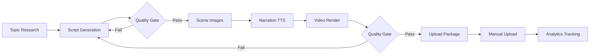

<p align="center">
  
</p>

<h1 align="center">MotivationOS</h1>
<p align="center"><strong>Your idea in. A Hindi-English motivational Short, ready to upload, out.</strong></p>

<p align="center">
  <a href="https://www.python.org/downloads/release/python-3120/"></a>
  <a href="https://fastapi.tiangolo.com/"></a>
  <a href="https://www.langchain.com/langgraph"></a>
  
  
  <a href="LICENSE"></a>
  
</p>

<p align="center">
  <a href="#quick-start"></a>
  <a href="#how-it-works"></a>
  <a href="#roadmap"></a>
</p>

<p align="center"><a href="https://github.com/parshav42/MotivationOS">GitHub</a> · Python 3.12 · Built for creators</p>

---

**MotivationOS turns a topic into a finished Hindi-English motivational YouTube Short; uploading it to YouTube is the one step you do yourself.**

Give it an idea like “stay consistent during exams.” MotivationOS drafts and checks a script, prepares scene visuals and narration, renders the video, and creates an upload package. It is for creators who want a repeatable production workflow without stitching together every step by hand.

## How it works



YouTube publishing stays manual. You review the finished package and upload it using YouTube Studio. The project can then retrieve YouTube analytics when channel access is configured.

## Quick start

New to Python? The commands below set up an isolated project environment, download the project libraries, and start one production run. You will need Python 3.12, FFmpeg, and a Groq API key.

### 1. Install the tools

- Install [Python 3.12](https://www.python.org/downloads/).
- Install [FFmpeg](https://ffmpeg.org/download.html), then confirm your computer can find it:

  ```bash
  ffmpeg -version
  ```

### 2. Download and prepare MotivationOS

```bash
git clone https://github.com/parshav42/MotivationOS.git
cd MotivationOS
python3.12 -m venv .venv
```

Activate the environment:

```bash
# macOS / Linux
source .venv/bin/activate

# Windows PowerShell
.venv\Scripts\Activate.ps1
```

Install the dependencies and create your private settings file:

```bash
python -m pip install --upgrade pip
pip install -r requirements.txt
```

```bash
# macOS / Linux
cp .env.example .env

# Windows PowerShell
Copy-Item .env.example .env
```

### 3. Add your API keys

Open `.env` in a text editor. Set `LLM_PROVIDER=groq` and add your Groq key to `GROQ_API_KEY`. Create a key in your [Groq account](https://console.groq.com/keys). Keep `.env` private; it contains credentials and should never be uploaded to GitHub.

For automatic scene images, set `IMAGE_PROVIDER=pixabay` and add a Pixabay API key to `PIXABAY_API_KEY`. Pixabay provides free, royalty-free images under its content license; keep the generated asset provenance with your production. Without an image provider, the app uses its manual licensed-image workflow. Select narration explicitly with `MOTIVATIONOS_TTS_PROVIDER=edge-tts` for free Edge TTS, or `elevenlabs` and its credentials if you use ElevenLabs.

### 4. Make your first video

```bash
python -m app.main --run-daily-pipeline
```

When it completes, the terminal prints the upload package path. Open that folder, review its video and metadata, then upload `final.mp4` through YouTube Studio.

> **The upload is always yours to approve.** MotivationOS prepares the package; this workflow does not publish the video to YouTube.

## What you get

| Stage | What MotivationOS does |
| --- | --- |
| Idea | Starts with a topic or niche. |
| Script | Uses an LLM provider to draft and evaluate a short script. Groq with GPT-OSS-120B is the primary setup; Sarvam and DeepSeek are supported alternatives. |
| Scenes | Matches the script with scene visuals. Pixabay API image search is available; local licensed assets can also be used. |
| Narration | Produces speech with Edge TTS or optional ElevenLabs. |
| Video | Combines narration, visuals, subtitles, and video into a rendered Short. FFmpeg is required. |
| Review package | Checks production quality and gathers the finished video and YouTube metadata in one package. |
| After upload | Stores YouTube operation data and can retrieve channel/video analytics when YouTube authorization is configured. |

## Optional: review dashboard

Start the local FastAPI app:

```bash
uvicorn app.api:app --host 127.0.0.1 --port 8000
```

Then open [http://127.0.0.1:8000/production-review](http://127.0.0.1:8000/production-review) to review productions. The server binds to your own computer (`127.0.0.1`).

Set `ADMIN_PASSWORD` in `.env` to choose the dashboard password (the default is `motivationos`; change it before using the dashboard). The password must be at least 4 characters. It is stored in the browser's `sessionStorage` only: refreshing the page keeps you signed in, while closing the tab logs you out. Changing the value in `.env` takes effect after restarting the server.

## Optional: daily email report

MotivationOS can send a daily production and YouTube report through Gmail SMTP. APScheduler runs it with the API app. Add a Gmail App Password to `SMTP_PASSWORD` in `.env` and set the recipient in `REPORT_EMAIL_TO`. The default cron schedule, `30 15 * * *`, runs at 15:30 UTC (9:00 PM India time). Set `REPORT_ENABLED=false` to turn it off. See `.env.example` for all report settings.

Send a report immediately:

```bash
python -m app.main --send-report-now
```

## Configuration at a glance

| Setting | Purpose |
| --- | --- |
| `LLM_PROVIDER` | Choose `groq`, `sarvam`, `deepseek`, or `huggingface`. |
| `GROQ_API_KEY` | Credentials for Groq when Groq is selected. |
| `IMAGE_PROVIDER` | Choose `pixabay`, `pollinations`, or `manual`. |
| `PIXABAY_API_KEY` | Required when using Pixabay images. |
| `MOTIVATIONOS_TTS_PROVIDER` | Select `edge-tts` or `elevenlabs`. |
| `MOTIVATIONOS_DB_PATH` | SQLite database location; defaults to `data/motivationos.sqlite3`. |
| `MOTIVATIONOS_OUTPUT_DIR` | Production output directory; defaults to `data/productions`. |

The complete configuration list and example values live in [`.env.example`](.env.example). Provider availability, free tiers, and account terms can change; check each provider's current documentation when creating an account.

## Run the tests

```bash
python -m pytest -q
```

The repository currently has **301 passing tests**.

## Roadmap

- [x] Topic-to-video production workflow
- [x] Script and production quality checks
- [x] Manual YouTube upload package
- [x] YouTube analytics integration
- [x] Daily email report option
- For proposed work, open an issue in the [GitHub repository](https://github.com/parshav42/MotivationOS/issues).

## Contributing

Issues and pull requests are welcome. Please describe the problem or change clearly, keep credentials out of commits, and run the test suite before opening a pull request.


<p align="center"><sub>Made in India 🇮🇳 · Built for the next story worth sharing.</sub></p>
