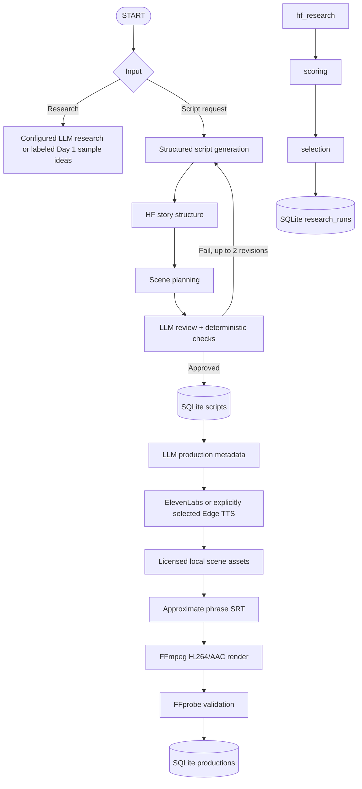

# MotivationOS

MotivationOS builds original Hindi-English motivational Shorts. Day 1 research and Day 2 script generation remain in LangGraph; Day 3 adds real audio, licensed visual acquisition, subtitles, video rendering, and resumable production records.

## LLM providers

DeepSeek is the default backend in `.env.example`, using `deepseek-v4-pro` for OpenAI-compatible chat completions. Set `LLM_PROVIDER=deepseek`, `DEEPSEEK_API_KEY`, and optionally `DEEPSEEK_MODEL` in your ignored local `.env`. The provider supports structured JSON generation used by script writing, scene planning, revision, and quality review.

Sarvam remains available as an optional backend: set `LLM_PROVIDER=sarvam` and `SARVAM_API_KEY`; `SARVAM_BASE_URL` defaults to `https://api.sarvam.ai/v1` and `SARVAM_MODEL_NAME` to `sarvam-105b`.

To use Hugging Face instead, set `LLM_PROVIDER=huggingface`, then configure `HF_TOKEN`, `HF_MODEL`, and optionally `HF_PROVIDER`. HF timeout and retry settings continue to apply to that provider only. Copy the provider settings from `.env.example`; never commit `.env`.

## Architecture

The typed LangGraph retains its original research route and selects the script path for a `script_request` or `selected_topic`. All LLM calls use the centralized provider interface and the backend selected by `LLM_PROVIDER`; there is no implicit mock fallback.



Research, story planning, scene planning, script generation, quality review, and video metadata share the configured LLM provider. Static Day 1 seed research is a separately labeled source and is not an LLM fallback. TTS and visual sourcing are independent media providers.

## Install

Python 3.10+, FFmpeg with `libx264`, AAC, and the `subtitles`/libass filter are required. FFprobe must be on `PATH`.

```bash
python3 -m venv .venv
source .venv/bin/activate
python -m pip install --upgrade pip
python -m pip install -r requirements.txt
cp .env.example .env
```

On Debian/Ubuntu, install the media tools with `sudo apt install ffmpeg fonts-noto-core`. The Noto Sans Devanagari font is requested for burned-in Hindi captions; libass/fontconfig may use an installed fallback. Confirm support with `ffmpeg -filters | grep subtitles` and `ffmpeg -encoders | grep libx264`.

## Configuration

### Hugging Face settings

- These settings are used only when `LLM_PROVIDER=huggingface`, or for the explicit `--check-hf` connectivity command. Create a Hugging Face user token with access to Inference Providers and keep it in your ignored local `.env`.
- `HF_MODEL` is the exact model repository/identifier supported by an available Inference Provider.
- `HF_PROVIDER` selects a supported Inference Provider or `auto`.
- `HF_TIMEOUT_SECONDS` and `HF_MAX_RETRIES` bound request time and retries; authentication and missing-model errors fail with configuration guidance.
- Hugging Face Inference Providers have model/provider-specific availability, quotas, and billing. Do not assume a model is free or unlimited; check current account/provider pricing before generating.

Connectivity uses an actual model inference request and reports the configured model/provider and returned response without displaying the token:

```bash
python -m app.main --check-hf
```

### YouTube manual upload and analytics (Day 4)

The default publishing workflow is manual: MotivationOS generates the script, video, and metadata; you upload the package in YouTube Studio and link its URL from the production review page. Analytics and daily reporting continue through Google's YouTube Analytics API. This does not change or replace the Day 1–3 LangGraph/video workflows.

- In Google Cloud, enable **YouTube Data API v3** and **YouTube Analytics API**, configure the OAuth consent screen, and add the channel owner as a test user where applicable. Do not bypass Google's verification or app restrictions.
- Use one Google Cloud API project for this API client. Configure the OAuth consent screen's app name, support/developer contacts, authorized domain, homepage, and public privacy policy. Publish the consent screen only after completing any required OAuth verification for the requested scopes; an External app left in Testing is limited to test users and may have short-lived refresh tokens.
- Create an OAuth **Web application** client with the exact authorized redirect URI `http://127.0.0.1:8000/api/youtube/auth/callback`; set `GOOGLE_CLIENT_ID` and `GOOGLE_CLIENT_SECRET`. The current callback validator is local-only. Use HTTPS and a hardened callback/auth boundary before non-local deployment.
- Set `GOOGLE_TOKEN_ENCRYPTION_KEY` to a Fernet key generated locally, for example with `.venv/bin/python -c 'from cryptography.fernet import Fernet; print(Fernet.generate_key().decode())'`. It encrypts OAuth credentials and resumable upload session URLs in SQLite. Back it up securely; losing/rotating it requires Google reauthorization and prevents resuming saved upload sessions.
- Set `MOTIVATIONOS_ADMIN_TOKEN` to a locally generated high-entropy secret. Every administrative route requires it as a Bearer token. Keep the API bound to loopback; do not expose it publicly without TLS and a hardened authentication/deployment boundary. The OAuth callback carries a one-time authorization code in its query string; disable Uvicorn access logging and configure any reverse proxy to redact callback query strings.
- By default, OAuth requests only `youtube.readonly` and `yt-analytics.readonly`. These scopes are used for uploads-playlist matching and analytics; they do not upload videos and do not require the YouTube API Services audit. Google OAuth consent-screen verification may still apply separately. Reauthorize after changing scopes.

#### Manual upload workflow

1. Produce a video and wait for status `ready_for_manual_upload` (final video and QA are complete).
2. Export its files with `python -m app.main --export-upload-package PRODUCTION_ID`. The command prints the exact `upload_package/` path next to `final.mp4`; it contains the video, title, description, tags, an optional thumbnail, and a short README.
3. Upload `final.mp4` in YouTube Studio, use the supplied metadata, choose Public visibility, and publish.
4. Open `http://127.0.0.1:8000/production-review`, enter the admin token and production ID, paste the YouTube URL into “Uploaded manually? Paste the YouTube URL”, and select Save. MotivationOS extracts the video ID, records a `manual` public upload, and marks the production `published`.
5. Analytics collection picks up the linked video ID automatically. The next daily report includes its available metrics and public URL; YouTube may take time to expose new-video metrics.

#### Optional auto-match

Set `YOUTUBE_AUTO_MATCH_ENABLED=true` and `MOTIVATIONOS_SCHEDULER_ENABLED=true` to poll the authenticated channel's uploads playlist every 15 minutes (override with `YOUTUBE_AUTO_MATCH_CRON`). The job uses `youtube.readonly`; it links an upload only when its title exactly matches one unique ready production title. Duplicate production titles are left unlinked for manual review. This read-only matching does not use `videos.insert` and does not require an API Services audit.

Start the local API:

```bash
set -a; . ./.env; set +a
.venv/bin/uvicorn app.api:app --host 127.0.0.1 --port 8000 --no-access-log
```

Call `GET /api/youtube/auth/start` with the admin Bearer token, visit its returned authorization URL, and complete consent. The loopback callback validates single-use OAuth state and PKCE, then stores encrypted credentials. `/api/youtube/status` reports configuration/connection state without returning tokens.

#### Legacy API upload mode

The existing API-based resumable upload implementation remains available but is disabled by default. `POST /api/publishing/{production_id}/upload` returns disabled unless `AUTO_PUBLISH_ENABLED=true`; only use it if the YouTube API Services audit and any Google OAuth verification required for the project have been completed. Enabling it requests the additional `youtube.upload` and `youtube.force-ssl` scopes and requires renewed consent. Explicit review, approval, public confirmation, channel verification, remote visibility checks, quota handling, and resumable upload protections remain in place.

The legacy automatic research-to-public-upload scheduler also remains opt-in through `AUTO_PUBLISH_ENABLED=true`, and additionally requires explicit auto-approval settings. Do not enable this workflow while API uploads are restricted. `AUTO_PUBLISH_ENABLED=false` is the default and leaves every API upload attempt disabled.

`GET /api/youtube/videos` lists the authenticated channel's uploads. Analytics endpoints query Google and persist only returned metric/date values; manual and API-linked video IDs use the same analytics pipeline. Empty results are marked unavailable, not fabricated zeroes. The default range is the prior 28 complete days because YouTube metrics may be delayed. Use `/api/analytics/channel` and `/api/analytics/videos/{video_id}` with optional ISO `start_date` and `end_date`.

`POST /api/reports/daily` saves Markdown under `MOTIVATIONOS_REPORT_DIR` (default `data/reports/`) before attempting email. Configure `SMTP_HOST`, `EMAIL_FROM`, `EMAIL_TO`, and, if required, `SMTP_USERNAME`/`SMTP_PASSWORD`; port 587 uses STARTTLS and 465 uses implicit TLS. If email settings are missing, the local report is still saved and email is `not_configured`. SMTP acceptance does not guarantee inbox delivery. An interrupted send is marked `delivery_unknown` and is not resent automatically.

Set `MOTIVATIONOS_SCHEDULER_ENABLED=true` to start the in-process UTC daily analytics/report job (default 08:00 UTC), and also to run optional auto-match when `YOUTUBE_AUTO_MATCH_ENABLED=true`. If the legacy API auto-publisher is separately enabled, its configured cron job shares the process and retains durable claims, upload leases, resumable sessions, uniqueness, quota reservations, and retry/backoff state. Database migrations retain existing production, script, research, and upload rows.

Google enforces OAuth consent/testing policies, channel permissions, analytics availability, and API upload restrictions. Manual uploads are performed by the channel owner in YouTube Studio. Do not enable the legacy unattended API publisher unless the authorized channel owner has explicitly reviewed its schedule, visibility, subscriber notifications, metadata behavior, and audit eligibility.

#### Live runbook

1. Fill `.env` from `.env.example`, including the Google client credentials, encryption key, admin token, HF/TTS settings, and licensed asset provenance. Keep secrets local; never commit `.env`.
2. Start the local API using the command above and authenticate the channel owner through `/api/youtube/auth/start`. By default, authorize only the read-only YouTube and Analytics scopes.
3. Produce a video, export its upload package, publish it through YouTube Studio, and link its URL in `/production-review`.
4. Optionally enable `YOUTUBE_AUTO_MATCH_ENABLED=true` with `MOTIVATIONOS_SCHEDULER_ENABLED=true` to match unique titles from the uploads playlist. Verify manual matches and daily report metrics.

### Narration

- The existing production TTS path requires an explicit `MOTIVATIONOS_TTS_PROVIDER` selection; it is unset by default. Selecting `elevenlabs` requires `ELEVENLABS_API_KEY` and an account-authorized `ELEVENLABS_VOICE_ID`. `ELEVENLABS_MODEL_ID` defaults to `eleven_multilingual_v2`. Provider usage is billed and quota-limited according to the current account plan.
- `MOTIVATIONOS_TTS_PROVIDER=edge-tts` explicitly selects the Edge TTS network service with `EDGE_TTS_VOICE` (default `hi-IN-SwaraNeural`). It has no API-key setting, but depends on network/service availability and applicable service terms. No synthetic/fake audio fallback exists.
- Audio is probed by FFprobe before it is accepted.

Day 9 adds an independent, opt-in audio foundation in `app.audio.generation`. It accepts only scripts already marked approved with review metadata and a passing evaluation, and reads their SQLite record without changing review state or creating production records. `build_audio_provider("mock")` selects a deterministic tone WAV fixture explicitly labeled as not speech; real providers are not selected or called by this module. `validate_audio_file` accepts WAV, MP3, M4A, AAC, FLAC, and OGG files, enforces a 25 MiB default limit (customizable with `max_size_bytes`), and uses FFprobe for compressed formats. The module is not connected to the video production workflow.

Run its offline tests with:

```bash
.venv/bin/pytest -q tests/test_audio_generation.py
```

Day 10 adds an opt-in Edge TTS adapter to the same interface. `MOTIVATIONOS_AUDIO_PROVIDER` is unset by default; select `mock` for a local tone fixture or `edge-tts` to explicitly allow the Edge network service. `MOTIVATIONOS_AUDIO_TIMEOUT_SECONDS` sets the request timeout, and the existing `EDGE_TTS_VOICE` selects the voice. The new module rejects ElevenLabs selection and never reads its credentials. Real generation remains a direct, explicit call to `generate_audio_for_approved_script`; it does not enter the video production, publishing, or scheduling workflows. Tests replace the Edge client and do not contact the service.

Day 11 adds independent offline checks in `app.audio.quality`. `run_audio_quality_assurance(path, target_duration_seconds=...)` returns file validity, format, duration, size, silence/clipping measurements, target deviation, findings, and a technical status. Defaults: 25 MiB maximum file size, 0.1-second minimum audio duration, 2-second target tolerance, silence below -50 dBFS for at least 0.25 seconds, clipping at or above 0.99 full scale, 10 ms measurement windows, 8 kHz compressed-audio analysis, 120-second analysis cap, and a 30-second FFmpeg timeout. WAV samples are inspected with Python's standard library. Compressed audio is decoded by FFmpeg to mono 8 kHz PCM; those signal measurements are marked approximate and always require review. Missing capabilities are reported as unavailable, not passed. A technical pass does not assess pronunciation, factual correctness, or voice naturalness.

Run the offline QA tests with:

```bash
.venv/bin/pytest -q tests/test_audio_quality.py
```

Day 12 adds `app.audio.review_service.generate_audio_for_human_review`. It requires an approved script ID, an explicit database path, output directory and simple output filename, and an explicitly selected provider. It returns generation metadata and the QA report together; the QA status is informational and never changes script review state or approves audio. The service is library-only: no API route is added because a request could create local files or invoke an explicitly selected network TTS provider. A local caller can present the returned structured report to a human reviewer. `needs_review`, `failed`, and unavailable checks remain visible as returned by the QA engine.

Day 13 refines the same library service into a structured workflow result. `workflow_status` reports `completed`, `blocked`, or `failed`; `generation_status` distinguishes `generated`, `not_run`, `unavailable`, `timed_out`, and `failed`; `qa_status` is passed through from the QA report or is `not_run`. The report includes script ID, provider type, generation metadata, QA findings, and safe error text. Provider details, filesystem paths, and internal exception text are not included in failure messages. A completed workflow is not audio approval: QA `needs_review` and `failed` remain separate human decisions.

### Licensed visuals

Set `MOTIVATIONOS_LICENSED_ASSET_DIR` to a directory of user-supplied, authorized still images. Day 3 does not scrape sites, follow arbitrary URLs, download creator content, or fabricate replacement assets. Provide one image for each scene, using `scene_01.jpg`, `scene_02.png`, etc. Supported formats: JPEG, PNG, WebP; minimum dimensions 320x320. Add a `LICENSES.json` file keyed by each exact filename:

```json
{
  "scene_01.jpg": {
    "source": "Provider or original creator/source record",
    "license": "License name and terms",
    "rights_holder": "Rights holder",
    "attribution": "Attribution required by the license, if any"
  }
}
```

The manifest is an operator-provided provenance assertion; MotivationOS does not independently adjudicate rights. Invalid, missing, or undocumented assets fail closed.

### Image generation

To use Pixabay, create an API key through the Pixabay API documentation, set `IMAGE_PROVIDER=pixabay`, and add the key as `PIXABAY_API_KEY` in your ignored local `.env`. Pixabay limits API searches (currently documented as 100 requests per minute per key); honor current account limits and retry later after HTTP 429 responses. MotivationOS requests vertical photos and records each image's creator, Pixabay page URL, image ID, and Pixabay Content License in `LICENSES.json`. Attribution is generally not required by that license, but retain the provenance and credit/link the creator when practical. Review Pixabay's current Content License and API terms before publishing or redistributing images.

Image generation is opt-in. Set `IMAGE_PROVIDER=pollinations` in `.env` to create missing scene images automatically; the default `IMAGE_PROVIDER=manual` preserves the existing local-image workflow. Pollinations requests use `POLLINATIONS_MODEL` (default `flux`) and vertical dimensions from `POLLINATIONS_WIDTH` and `POLLINATIONS_HEIGHT` (defaults `1080x1920`). Generated files and their provenance are saved in `MOTIVATIONOS_LICENSED_ASSET_DIR` and `LICENSES.json`. Existing images are reused as manual overrides and are not regenerated unless explicitly requested.

The basic Pollinations endpoint can be used without a key. Its free tier is rate-limited to roughly one request every 15 seconds, so a multi-scene script may take a little while; retries use increasing delays. Check Pollinations' current account and API documentation for how to obtain and configure an optional `POLLINATIONS_API_KEY`. Never commit that key.

Generate or reuse images for every scene, or force regeneration for one scene:

```bash
python -m app.main --generate-images 6
python -m app.main --regenerate-image 6 1
```

To return to manually supplied images, set `IMAGE_PROVIDER=manual`; provide one authorized image per scene and its provenance in `LICENSES.json`. Pollinations images are intended for prototyping. Review Pollinations' current terms of use and applicable downstream platform policies, including YouTube's, before publishing.

### Paths

- `MOTIVATIONOS_DB_PATH` defaults to `data/motivationos.sqlite3`. `scripts` and `productions` tables are additive; existing research data is preserved.
- `MOTIVATIONOS_SPEAKING_RATE_WPS` defaults to `2.5`; duration checks allow narration within a bounded range around that assumption.
- `MOTIVATIONOS_OUTPUT_DIR` defaults to `data/productions`. Each run receives a unique production ID directory containing `assets/`, `captions.srt`, `final.mp4`, and `metadata.json` when those stages complete.
- `LANGSMITH_*` only configure optional tracing and do not replace the HF model provider.

## Commands

Generate a Day 2 script (requires HF configuration):

```bash
python -m app.main --topic "Consistency during exam season" --duration 35
```

Every generated script is saved as `needs_review`, even when its automated quality evaluation passes. A passing evaluation makes it eligible for human review; it is not approval. The `--draft-for-review` flag remains as a deprecated compatibility option.

`MIN_SCRIPT_QUALITY_SCORE` sets the quality threshold used for script evaluation (default `7.5`); the same setting is used by the publishing quality gate. The legacy `MOTIVATIONOS_QUALITY_THRESHOLD` remains a fallback when `MIN_SCRIPT_QUALITY_SCORE` is unset. Lowering the threshold does not bypass any of the eleven required evaluation checks.

### Fully automated pipeline

`--run-daily-pipeline` generates and reviews one script, creates or reuses licensed scene images, renders the video, checks QA and provenance, records synthetic approval audit entries, and exports a ready-to-upload package. It never uploads or publishes to YouTube; the YouTube upload remains manual by design.

```bash
.venv/bin/python -m app.main --run-daily-pipeline
```

`AUTO_APPROVE_SCRIPTS` and `AUTO_APPROVE_PRODUCTIONS` default to `true`; set either to `false` to stop at that manual review gate. `MIN_SCRIPT_QUALITY_SCORE` uses a 0–100 scale for this command (default `75`; existing 0–10 values are accepted for compatibility). A script must score strictly above the threshold. `DAILY_PIPELINE_MAX_SCRIPT_RETRIES` defaults to `3` retries after the first draft. `DAILY_PIPELINE_NICHE` optionally overrides the selected topic. Approval stops if QA, recorded video hash, or any scene's `LICENSES.json` source/license/rights-holder provenance is missing.

To schedule the pipeline, set `DAILY_PIPELINE_CRON` to a five-field UTC cron expression, for example `0 8 * * *`, and start the API scheduler with `MOTIVATIONOS_SCHEDULER_ENABLED=true`. Each scheduled run logs its timestamp and outcome. The dashboard at `/production-review` also has a **Run daily pipeline** action with polled progress.

If a run fails after rendering, use its production ID with `python -m app.main --resume-production <production_id>`; after the required review gate is resolved, export with `python -m app.main --export-upload-package <production_id>`. If it stops at script review, use `--approve-script <script_id> --reviewer "Your Name"`, then continue with `--generate-images <script_id>` and `--produce-script <script_id>`. The only publishing step is still the manual YouTube Studio upload.

Approve a passing script from the CLI after a person has reviewed it:

```bash
python -m app.main --approve-script 5 --reviewer "Your Name"
python -m app.main --produce-script 5
```

The approval command uses the same atomic database review operation as the authenticated dashboard API. It writes `status`, `reviewed_at`, and `reviewed_by` together, and refuses scripts without a valid passing evaluation. Already-reviewed records cannot be reviewed again. Add `--debug` to a production command to re-raise workflow-caught exceptions with a traceback; errors from stages that create a production record are reported in that record.

Use the authenticated local API to review scripts:

- `GET /api/scripts/review` lists scripts awaiting review.
- `GET /api/scripts/{script_id}/review` returns the script's current review state.
- `POST /api/scripts/{script_id}/approve` explicitly approves a passing script.
- `POST /api/scripts/{script_id}/reject` explicitly rejects a script.

Approval and rejection require the admin Bearer token and a JSON body containing `{"confirm_review": true, "reviewer": "your-reviewer-id"}`. Script review is separate from YouTube publishing approval. The review endpoints only update script review state; they do not start production or upload a video.

Unreviewed legacy scripts with status `completed` also appear in the review queue. They are not production-approved; an admin must make a new confirmed decision. The review details response includes the script and its quality evaluation so the reviewer can inspect both before deciding.

### Local Script Review Dashboard (Day 8)

The same FastAPI service serves a local review UI at `http://127.0.0.1:8000/review`. It uses the existing review endpoints and has no production, scheduling, or publishing controls. On the sign-in form, enter a reviewer name and the value configured as `MOTIVATIONOS_ADMIN_TOKEN`; the token stays in page memory only and is cleared on sign-out or when the tab closes. The browser sends it only as the Bearer token to the same-origin local API.

Start the dashboard from the project directory. The `.env` file must already contain a locally configured admin token; do not paste or print it in a command:

```bash
cd ~/MotivationOS
source .venv/bin/activate
set -a
. ./.env
set +a
export MOTIVATIONOS_SCHEDULER_ENABLED=false
.venv/bin/uvicorn app.api:app --host 127.0.0.1 --port 8000 --no-access-log
```

Open `http://127.0.0.1:8000/review` in your browser. The service is bound to loopback and must not be exposed publicly. The UI does not persist the admin token. Approving only changes script review status and makes an eligible script available to the separate production command; it never starts production. Rejection records the decision and removes the script from the review queue. These decisions update the database selected by `MOTIVATIONOS_DB_PATH` (default `data/motivationos.sqlite3`), so use a separate temporary database when exploring with test data.

Run the focused dashboard and review tests, check JavaScript syntax, and compile Python with:

```bash
.venv/bin/pytest -q tests/test_review_dashboard.py tests/test_script_review.py
node --check app/static/review.js
python -m compileall -q app
git diff --check
```

Run the full offline test suite with:

```bash
.venv/bin/pytest -q
```

For local development, set an admin token in your shell and start the API on loopback with scheduled jobs disabled:

```bash
export MOTIVATIONOS_ADMIN_TOKEN='replace-with-a-local-test-value'
export MOTIVATIONOS_SCHEDULER_ENABLED=false
.venv/bin/uvicorn app.api:app --host 127.0.0.1 --port 8000 --no-access-log
```

In another terminal, list pending and legacy scripts or inspect one script. Replace `1` with an ID from the list:

```bash
curl -H "Authorization: Bearer $MOTIVATIONOS_ADMIN_TOKEN" http://127.0.0.1:8000/api/scripts/review
curl -H "Authorization: Bearer $MOTIVATIONOS_ADMIN_TOKEN" http://127.0.0.1:8000/api/scripts/1/review
```

Approval or rejection requires a deliberate POST with `confirm_review: true`; for example:

```bash
curl -X POST http://127.0.0.1:8000/api/scripts/1/approve \\
  -H "Authorization: Bearer $MOTIVATIONOS_ADMIN_TOKEN" \\
  -H 'Content-Type: application/json' \\
  -d '{"confirm_review":true,"reviewer":"local-admin"}'
```

Run the isolated review, database, and script-workflow tests with:

```bash
.venv/bin/pytest -q tests/test_script_review.py tests/test_database.py tests/test_script_workflow.py
```

This local review walkthrough does not require an LLM call. Production remains separately gated on a passing evaluation and recorded human approval; the API review routes do not render video, upload or schedule YouTube content, or send email. The Day 7 verification uses temporary databases and mocked production gates. Real media rendering, YouTube actions, email delivery, and paid-provider behavior are not part of that verification.

Retain Day 1's bundled sample research, or explicitly use HF research:

```bash
python -m app.main --research
python -m app.main --research-with-hf --niche "Hinglish discipline"
```

Produce a video from a script-table record only after explicit script approval. Legacy `completed` records are not treated as approved:

```bash
python -m app.main --produce-script 2
```

The command prints the actual production status and MP4 path only after FFprobe validation. On failure, it persists the error and intermediate metadata and prints a resume command:

```bash
python -m app.main --resume-production <PRODUCTION_ID>
```

Production runs the HF metadata stage, TTS, local licensed asset acquisition, SRT generation, FFmpeg render, and FFprobe verification. Subtitles are UTF-8 phrase captions with approximate scene/word-count timing; no forced aligner is currently integrated. The renderer creates 1080x1920, 9:16, 30 FPS H.264/AAC MP4 with burned captions and scene transitions.

## Production Recovery and Tests

Production states (`queued`, `generating_audio`, `acquiring_visuals`, `generating_subtitles`, `rendering`, `completed`, `failed`) and stage metadata are stored in SQLite and mirrored to `metadata.json`. Failures preserve validated intermediate assets. `--resume-production` reuses a probed narration file and reacquires/revalidates visuals before rendering.

Run all tests:

```bash
pytest -v
```

Tests use temporary generated images, an explicitly marked tone-audio fixture, and injected fake model/TTS providers. The production integration test invokes the real local FFmpeg and FFprobe binaries and validates the rendered MP4; it does not contact HF or ElevenLabs, use real licensed footage, or claim an actual user production was created. A real production requires valid provider configuration and a fully documented asset library.

## Quality and Limitations

Quality scores combine local checks (language, speaking pace, repetition, beat labels, caption-to-scene alignment, factual claims, and outcome guarantees) with HF qualitative review. The per-check report is retained with each new script row; scores are not engagement predictions. Originality/factual checks are safeguards, not guarantees. HF provider availability, quota, and cost vary by model and account. Hinglish pronunciation depends on the selected TTS voice. SRT alignment is approximate. Local image licensing information must be supplied and verified by the operator. No video is produced if credentials, authorized assets, TTS, FFmpeg, or media validation fail.

Day 3 keeps API-based YouTube upload as a disabled optional integration; the normal workflow is manual upload with automated production, metadata, analytics, and reporting. No API secret belongs in source control.
