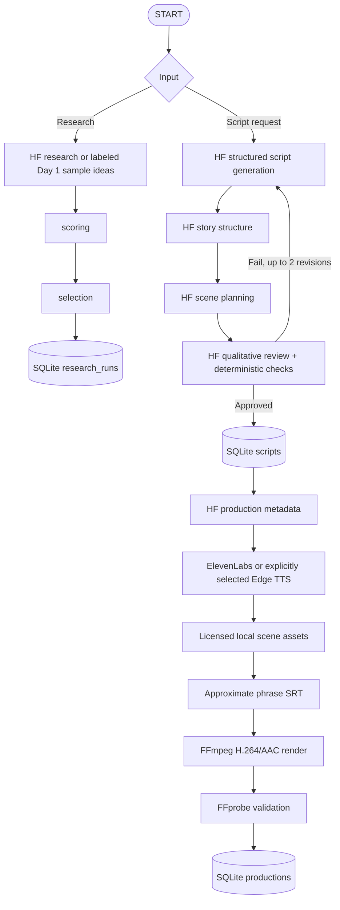

# MotivationOS

MotivationOS builds original Hindi-English motivational Shorts. Day 1 research and Day 2 script generation remain in LangGraph; Day 3 adds real audio, licensed visual acquisition, subtitles, video rendering, and resumable production records.

## Architecture

The typed LangGraph retains its original research route and selects the script path for a `script_request` or `selected_topic`. All LLM calls use the centralized `HuggingFaceLLMProvider` and the official `huggingface_hub.InferenceClient`; the application has no OpenAI integration or implicit mock fallback.



Research, story planning, scene planning, script generation, quality review, and video metadata share Hugging Face. Static Day 1 seed research is a separately labeled source and is not an LLM fallback. TTS and visual sourcing are independent media providers.

## Install

Python 3.10+, FFmpeg with `libx264`, AAC, and the `subtitles`/libass filter are required. FFprobe must be on `PATH`.

```bash
python3 -m venv .venv
source .venv/bin/activate
python -m pip install --upgrade pip
python -m pip install -r requirements.txt
cp .env.example .env
```

On Debian/Ubuntu, install the media tools with `sudo apt install ffmpeg fonts-noto-core`. The Noto Sans Devanagari font is requested for burned-in Hindi captions; libass/fontconfig may use an installed fallback. Confirm support with `ffmpeg -filters | grep subtitles` and `ffmpeg -encoders | grep libx264`.

## Configuration

### Hugging Face LLM

- `HF_TOKEN` is required for script generation, HF research, story/scene planning, quality review, metadata, and `--check-hf`. Create a Hugging Face user token with access to Inference Providers and keep it in your ignored local `.env`.
- `HF_MODEL` is the exact model repository/identifier supported by an available Inference Provider.
- `HF_PROVIDER` selects a supported Inference Provider or `auto`.
- `HF_TIMEOUT_SECONDS` and `HF_MAX_RETRIES` bound request time and retries; authentication and missing-model errors fail with configuration guidance.
- Hugging Face Inference Providers have model/provider-specific availability, quotas, and billing. Do not assume a model is free or unlimited; check current account/provider pricing before generating.

Connectivity uses an actual model inference request and reports the configured model/provider and returned response without displaying the token:

```bash
python -m app.main --check-hf
```

### YouTube publishing and analytics (Day 4)

The local FastAPI service uses Google's official YouTube Data API v3 and YouTube Analytics API. It does not change or replace the Day 1–3 LangGraph/video workflows.

- In Google Cloud, enable **YouTube Data API v3** and **YouTube Analytics API**, configure the OAuth consent screen, and add the channel owner as a test user where applicable. Do not bypass Google's verification or app restrictions.
- Create an OAuth **Web application** client with the exact authorized redirect URI `http://127.0.0.1:8000/api/youtube/auth/callback`; set `GOOGLE_CLIENT_ID` and `GOOGLE_CLIENT_SECRET`. The current callback validator is local-only. Use HTTPS and a hardened callback/auth boundary before non-local deployment.
- Set `GOOGLE_TOKEN_ENCRYPTION_KEY` to a Fernet key generated locally, for example with `.venv/bin/python -c 'from cryptography.fernet import Fernet; print(Fernet.generate_key().decode())'`. It encrypts OAuth credentials and resumable upload session URLs in SQLite. Back it up securely; losing/rotating it requires Google reauthorization and prevents resuming saved upload sessions.
- Set `MOTIVATIONOS_ADMIN_TOKEN` to a locally generated high-entropy secret. Every administrative route requires it as a Bearer token. Keep the API bound to loopback; do not expose it publicly without TLS and a hardened authentication/deployment boundary. The OAuth callback carries a one-time authorization code in its query string; disable Uvicorn access logging and configure any reverse proxy to redact callback query strings.
- The OAuth flow requests only `youtube.upload`, `youtube.readonly`, and `yt-analytics.readonly`. Google may require consent-screen setup, test-user access, verification, or reauthorization depending on project state and account policy. OAuth Testing mode may restrict refresh-token lifetime; monitor `/api/youtube/status` and reauthorize when required.

Start the local API:

```bash
set -a; . ./.env; set +a
.venv/bin/uvicorn app.api:app --host 127.0.0.1 --port 8000 --no-access-log
```

Call `GET /api/youtube/auth/start` with the admin Bearer token, visit its returned authorization URL, and complete consent. The loopback callback validates single-use OAuth state and PKCE, then stores encrypted credentials. `/api/youtube/status` reports configuration/connection state without returning tokens.

Publishing requires three separate human actions. A completed production must have its actual `final.mp4` and Day 3 `metadata.json`. `POST /api/publishing/{production_id}/review` validates both and snapshots the generated title, description, tags, language, and category for inspection. `POST /api/publishing/{production_id}/approve` requires `{"confirm_approval":true}`; public visibility additionally requires `{"confirm_public":true}`. Only then can `POST /api/publishing/{production_id}/upload` upload. Visibility defaults to private, and public publishing is never scheduled. An upload is reported as successful only after YouTube returns a video ID.

Uploads use the official resumable MediaUpload API. Each production has a unique upload record, and its ID is embedded as a description reconciliation marker. Interrupted sessions resume with the encrypted saved session URL. If the outcome is ambiguous and no resumable URL exists, automatic re-upload is blocked. `POST /api/publishing/{production_id}/reconcile` searches the authenticated channel for that exact marker and persists an ID only when exactly one match is returned. No match does not authorize automatic re-upload. Inspect durable state at `/api/publishing/{production_id}/status`; cancellation retains its audit record.

`GET /api/youtube/videos` lists the authenticated channel's uploads. Analytics endpoints query Google and persist only returned metric/date values; empty results are marked unavailable, not fabricated zeroes. The default range is the prior 28 complete days because YouTube metrics may be delayed. Use `/api/analytics/channel` and `/api/analytics/videos/{video_id}` with optional ISO `start_date` and `end_date`.

`POST /api/reports/daily` saves Markdown under `MOTIVATIONOS_REPORT_DIR` (default `data/reports/`) before attempting email. Configure `SMTP_HOST`, `EMAIL_FROM`, `EMAIL_TO`, and, if required, `SMTP_USERNAME`/`SMTP_PASSWORD`; port 587 uses STARTTLS and 465 uses implicit TLS. If email settings are missing, the local report is still saved and email is `not_configured`. SMTP acceptance does not guarantee inbox delivery. An interrupted send is marked `delivery_unknown` and is not resent automatically.

Set `MOTIVATIONOS_SCHEDULER_ENABLED=true` to start the in-process UTC daily analytics/report job (default 08:00 UTC). It never uploads or publishes. SQLite stores job claims and limits retries to three; duplicate daily executions are blocked. The API also exposes an authenticated manual trigger. All new tables are additive; existing production, script, and research rows are retained.

Google enforces project-level API quotas, OAuth consent/testing policies, channel permissions, and upload restrictions. Check current quota in Google Cloud Console before production use. Unverified YouTube API projects may be restricted to private visibility; respect the current project-specific restriction and API terms. Quota exhaustion, API enablement errors, delayed metrics, or revoked credentials are surfaced as failures, not successful operations.

### Narration

- Default `MOTIVATIONOS_TTS_PROVIDER=elevenlabs` requires `ELEVENLABS_API_KEY` and an account-authorized `ELEVENLABS_VOICE_ID`. `ELEVENLABS_MODEL_ID` defaults to `eleven_multilingual_v2`, which supports multilingual Hindi input. Provider usage is billed and quota-limited according to the current account plan.
- `MOTIVATIONOS_TTS_PROVIDER=edge-tts` explicitly selects the Edge TTS network service with `EDGE_TTS_VOICE` (default `hi-IN-SwaraNeural`). It has no API-key setting, but depends on network/service availability and applicable service terms. No synthetic/fake audio fallback exists.
- Audio is probed by FFprobe before it is accepted.

### Licensed visuals

Set `MOTIVATIONOS_LICENSED_ASSET_DIR` to a directory of user-supplied, authorized still images. Day 3 does not scrape sites, follow arbitrary URLs, download creator content, or fabricate replacement assets. Provide one image for each scene, using `scene_01.jpg`, `scene_02.png`, etc. Supported formats: JPEG, PNG, WebP; minimum dimensions 320x320. Add a `LICENSES.json` file keyed by each exact filename:

```json
{
  "scene_01.jpg": {
    "source": "Provider or original creator/source record",
    "license": "License name and terms",
    "rights_holder": "Rights holder",
    "attribution": "Attribution required by the license, if any"
  }
}
```

The manifest is an operator-provided provenance assertion; MotivationOS does not independently adjudicate rights. Invalid, missing, or undocumented assets fail closed.

### Paths

- `MOTIVATIONOS_DB_PATH` defaults to `data/motivationos.sqlite3`. `scripts` and `productions` tables are additive; existing research data is preserved.
- `MOTIVATIONOS_SPEAKING_RATE_WPS` defaults to `2.5`; duration checks allow narration within a bounded range around that assumption.
- `MOTIVATIONOS_OUTPUT_DIR` defaults to `data/productions`. Each run receives a unique production ID directory containing `assets/`, `captions.srt`, `final.mp4`, and `metadata.json` when those stages complete.
- `LANGSMITH_*` only configure optional tracing and do not replace the HF model provider.

## Commands

Generate a Day 2 script (requires HF configuration):

```bash
python -m app.main --topic "Consistency during exam season" --duration 35
```

Use `--draft-for-review` to keep the saved script in `needs_review` even when automated checks pass. Generated scripts are never human-approved by the model.

Retain Day 1's bundled sample research, or explicitly use HF research:

```bash
python -m app.main --research
python -m app.main --research-with-hf --niche "Hinglish discipline"
```

Produce a video from an existing script-table record only when its status is `completed`:

```bash
python -m app.main --produce-script 2
```

The command prints the actual production status and MP4 path only after FFprobe validation. On failure, it persists the error and intermediate metadata and prints a resume command:

```bash
python -m app.main --resume-production <PRODUCTION_ID>
```

Production runs the HF metadata stage, TTS, local licensed asset acquisition, SRT generation, FFmpeg render, and FFprobe verification. Subtitles are UTF-8 phrase captions with approximate scene/word-count timing; no forced aligner is currently integrated. The renderer creates 1080x1920, 9:16, 30 FPS H.264/AAC MP4 with burned captions and scene transitions.

## Production Recovery and Tests

Production states (`queued`, `generating_audio`, `acquiring_visuals`, `generating_subtitles`, `rendering`, `completed`, `failed`) and stage metadata are stored in SQLite and mirrored to `metadata.json`. Failures preserve validated intermediate assets. `--resume-production` reuses a probed narration file and reacquires/revalidates visuals before rendering.

Run all tests:

```bash
pytest -v
```

Tests use temporary generated images, an explicitly marked tone-audio fixture, and injected fake model/TTS providers. The production integration test invokes the real local FFmpeg and FFprobe binaries and validates the rendered MP4; it does not contact HF or ElevenLabs, use real licensed footage, or claim an actual user production was created. A real production requires valid provider configuration and a fully documented asset library.

## Quality and Limitations

Quality scores combine local checks (language, speaking pace, repetition, beat labels, caption-to-scene alignment, factual claims, and outcome guarantees) with HF qualitative review. The per-check report is retained with each new script row; scores are not engagement predictions. Originality/factual checks are safeguards, not guarantees. HF provider availability, quota, and cost vary by model and account. Hinglish pronunciation depends on the selected TTS voice. SRT alignment is approximate. Local image licensing information must be supplied and verified by the operator. No video is produced if credentials, authorized assets, TTS, FFmpeg, or media validation fail.

Day 3 leaves YouTube upload/publishing, a forced-alignment transcription provider, and automatic licensed image/video generation for future integrations. No API secret belongs in source control.